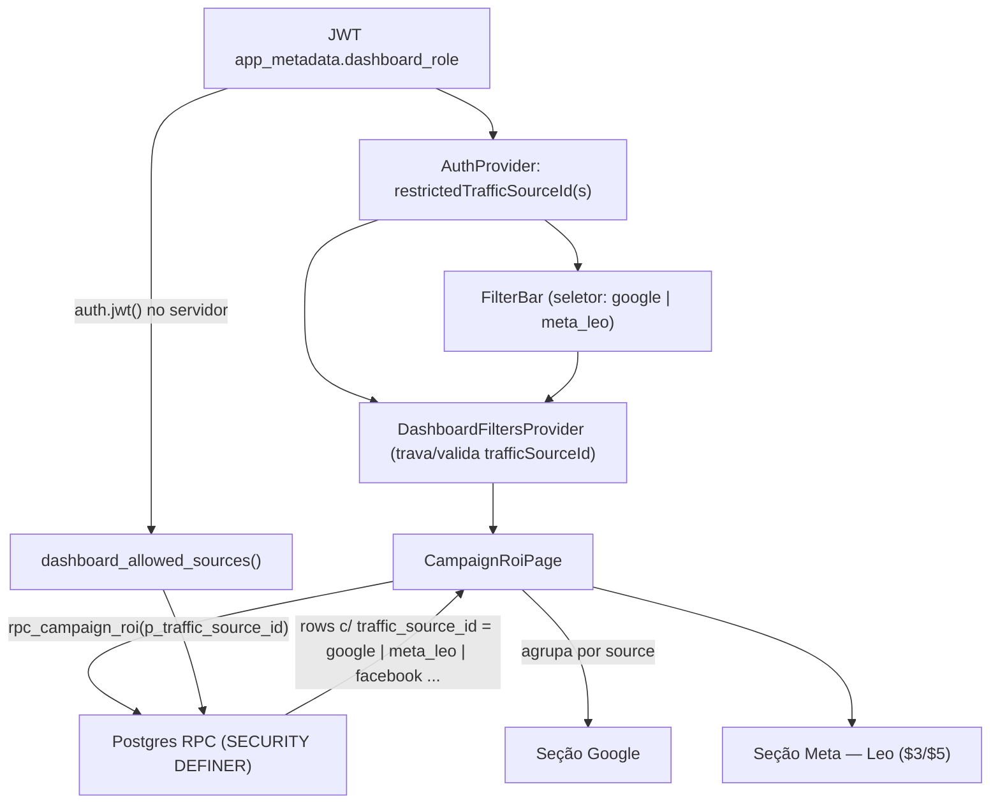

# Leo — Campanhas Meta ($3 / $5) no ROI de Campanhas — Planning Output (v1)

> **Status:** PLANEJADO — Aguardando aprovação (nada implementado, nada aplicado no banco)
> **Data:** 2026-11-16
> **Scope:** `/roi-campanhas` (`CampaignRoiPage`), RPCs `rpc_campaign_roi`, `rpc_webinar_products_for_campaign`, `rpc_dashboard_filter_options`
> **Files:** 6 arquivos (2 novos, 4 modificados)
> **Risk:** 🔴 HIGH (RPCs com `SECURITY DEFINER`, isolamento de acesso por role, query pesada em produção)

---

## Decisões do stakeholder (2026-11-16) — substituem as perguntas em aberto no fim deste doc

1. Leo = `lmflix68@gmail.com`.
2. Admin **não muda**: as campanhas `$3/$5` continuam no grupo de origem (Facebook), sem duplicar eventos. `meta_leo` só é materializada para o role `leo_traffic` ou quando o filtro `meta_leo` é pedido explicitamente (`dashboard_source_of(..., p_leo)`).
3. Vendas `$3/$5` sem sinal de Meta (`unknown`) **entram** em `meta_leo` (fonte `facebook` ou `unknown` + prefixo).
4. "Sobrevivência": sem critério adicional.
5. Leo vê **só** `/roi-campanhas` (sidebar com 1 item + redirect das demais rotas).

**Status de implementação:** código + migration prontos e validados em sandbox (rollback); **migration e role NÃO aplicados em produção** (aguardando OK).

---

## 0. Technical Specification (EN)

### Point 1 — Separate "Leo / Meta" dataset
- **Issue:** Leo (YouTube = `google` source) must also see his Meta campaigns, identified by `utm_campaign` starting with `$3` or `$5`. Today those rows are mixed into the generic `facebook` group (10,916 front sales / 206 campaigns; other managers use `$2`, `$`, `$+|+…`, so the prefix is discriminating).
- **Suspected Root Cause:** the dashboard only models one dimension (`traffic_source_id`). Isolation roles are `<source>_only` → exactly one source, so one user cannot see two datasets.
- **Target Outcome:** a virtual source `meta_leo` produced server-side (facebook ∧ campaign matches `^\s*\$\s*(3|5)(\D|$)`), shown as its own section "Meta — Leo ($3/$5)" in the ROI page. A new role `leo_traffic` is allowed `{google, meta_leo}` only.
- **Risks & Mitigation:** see §5 of this doc (Risk table) and §11 (Rollback).

### Point 2 — Pre-existing isolation regression (found in audit, must be fixed in the same migration)
- **Issue:** the **live** `rpc_campaign_roi(…, text, text)` and `rpc_webinar_products_for_campaign(…)` contain **no** `dashboard_role` check (verified with `pg_get_functiondef` on 2026-11-16; only `rpc_dashboard_filter_options` still has it).
- **Suspected Root Cause:** migration `20261001140000_campaign_roi_product_filter.sql` re-created both functions from the pre-isolation version, dropping the `caller_role/effective_filter` CTEs added in `20260725190000`.
- **Target Outcome:** isolation enforced again server-side for every `<source>_only` user (today `google_only`: lmflix68; `tiktok_only`: moovemidias, usertiktok) — a call with `p_traffic_source_id => null` currently returns all sources to them.
- **Risks & Mitigation:** restoring the check changes what those users see (correctly). Validate with simulated JWTs before/after.

### Audit points (automatic)
- **Logic & State:** `restrictedTrafficSourceId` (single string) → must become a list; the "reset trafficSourceId if not in options" effect (`filter-bar.tsx` L93-101) would wipe `meta_leo` because the MV has no such source.
- **Component structure:** no new components; only labels/option lists.
- **React DOM:** no scroll/lifecycle impact; `campaign-roi.tsx` already groups by `traffic_source_id` so the new group renders without structural change.

---

## 1. Contexto

- `/roi-campanhas` lista receita por campanha agrupada por `traffic_source_id` (`campaign-roi.tsx` L36-43, L215-233).
- Isolamento por usuário existe (Story 1.4): `dashboard_role = "<source>_only"` força a fonte no servidor e esconde o seletor no client.
- Usuários com role hoje (live): `lmflix68@gmail.com = google_only`, `moovemidias@gmail.com = tiktok_only`, `usertiktok@gmail.com = tiktok_only`, `time.melhorversao@gmail.com = dashboard_admin`.
- Dados ao vivo (vendas front, tabela `funnel_events`): facebook com prefixo `$3`/`$5` = 10.916 vendas / 206 campanhas; 28 vendas com o prefixo caem em `unknown` (sem fbclid/utm_source reconhecido); `google` = 2.981 vendas (campanhas são IDs numéricos).
- **Premissa a confirmar:** Leo = `lmflix68@gmail.com` (único usuário `google_only`).

---

## 2. Referência de Código Mapeada

### 2.1 Fonte do `traffic_source_id` (sempre derivada igual em todas as RPCs)
[20261001140000_campaign_roi_product_filter.sql L78-97](file:///Users/brunogovas/Projects/Pandora-Box/melhor-versao-dashboard/supabase/migrations/20261001140000_campaign_roi_product_filter.sql#L78-L97)

```sql
  with base as (
    select
      coalesce(e.traffic_source_id, public.classify_traffic_source(
        e.metadata->>'utm_source',
        e.metadata->>'fbclid',
        e.metadata->>'ttclid',
        e.metadata->>'gclid',
        e.metadata->>'src',
        e.metadata->>'sck'
      ), 'unknown') as traffic_source_id,
      e.event_type,
      ...
      coalesce(e.metadata->>'utm_campaign', 'Sem campanha') as utm_campaign,
```
↑ É aqui que `meta_leo` será derivado (facebook + prefixo), sem tocar na coluna `traffic_source_id` gravada.

### 2.2 Filtro por fonte que será substituído
[20261001140000 L115-125](file:///Users/brunogovas/Projects/Pandora-Box/melhor-versao-dashboard/supabase/migrations/20261001140000_campaign_roi_product_filter.sql#L115-L125)

```sql
      and (
        p_traffic_source_id is null
        or coalesce(e.traffic_source_id, public.classify_traffic_source( ... ), 'unknown') = p_traffic_source_id
      )
```

### 2.3 Padrão de isolamento por role (perdido na migration 20261001, a restaurar)
[20260725190000_generalize_source_only_role_isolation.sql L39-48](file:///Users/brunogovas/Projects/Pandora-Box/melhor-versao-dashboard/supabase/migrations/20260725190000_generalize_source_only_role_isolation.sql#L39-L48)

```sql
  with caller_role as (
    select coalesce((select auth.jwt() -> 'app_metadata' ->> 'dashboard_role'), '') as dashboard_role
  ),
  effective_filter as (
    select case
      when (select dashboard_role from caller_role) ~ '_only$'
        then regexp_replace((select dashboard_role from caller_role), '_only$', '')
      else p_traffic_source_id
    end as traffic_source_id
  ),
```
↑ Mesma leitura de `app_metadata` (não `user_metadata`) — Context7/Supabase confirma que `raw_app_meta_data` não é editável pelo usuário e é o lugar correto para autorização; e que o JWT só reflete mudança após refresh/relogin.

### 2.4 `rpc_dashboard_filter_options` live (já tem isolamento)
(definição lida do banco em 2026-11-16)

```sql
  effective_filter as (
    select case
      when (select dashboard_role from caller_role) ~ '_only$'
        then regexp_replace((select dashboard_role from caller_role), '_only$', '')
      else null
    end as traffic_source_id
  )
  select mv.funnel_id, mv.country, mv.funnel_variant, mv.traffic_source_id, ...
  from public.dashboard_filter_options_mv mv
  where ((select traffic_source_id from effective_filter) is null
         or mv.traffic_source_id = (select traffic_source_id from effective_filter))
```

### 2.5 Derivação do source restrito no client
[auth-context.tsx L34-38](file:///Users/brunogovas/Projects/Pandora-Box/melhor-versao-dashboard/src/contexts/auth-context.tsx#L34-L38)

```ts
function deriveRestrictedTrafficSourceId(dashboardRole: string | null): string | null {
  if (!dashboardRole) return null
  const match = dashboardRole.match(/^(.+)_only$/)
  return match ? match[1] : null
}
```

### 2.6 Lock do filtro no client
[dashboard-filters-context.tsx L47-69](file:///Users/brunogovas/Projects/Pandora-Box/melhor-versao-dashboard/src/contexts/dashboard-filters-context.tsx#L47-L69)

```ts
return restrictedTrafficSourceId ? { ...next, trafficSourceId: restrictedTrafficSourceId } : next
...
useEffect(() => { if (restrictedTrafficSourceId) { setFiltersState(... trafficSourceId: restrictedTrafficSourceId ...) } }, [restrictedTrafficSourceId])
```

### 2.7 Seletor de fonte + reset por opções
[filter-bar.tsx L83-101, L192-215](file:///Users/brunogovas/Projects/Pandora-Box/melhor-versao-dashboard/src/components/composites/filter-bar.tsx#L83-L101)

```tsx
  const trafficSourceOptions = Array.from(new Set(options.filter(...).map((o) => o.traffic_source_id ?? "unknown")))
    .sort((a, b) => labelTrafficSource(a).localeCompare(labelTrafficSource(b)))

  useEffect(() => {
    if (filters.trafficSourceId && trafficSourceOptions.length > 0 && !trafficSourceOptions.includes(filters.trafficSourceId)) {
      setFilters((current) => ({ ...current, trafficSourceId: null }))
    }
  }, [filters.trafficSourceId, setFilters, trafficSourceOptions])
  ...
  {showTrafficSource && !restrictedTrafficSourceId && ( <Select ...> )}
```

### 2.8 Agrupamento da página
[campaign-roi.tsx L19-43, L87-89](file:///Users/brunogovas/Projects/Pandora-Box/melhor-versao-dashboard/src/pages/campaign-roi.tsx#L19-L43)

```tsx
const trafficSourceLabels: Record<string, string> = {
  facebook: "Facebook / Meta", tiktok: "TikTok", youtube: "YouTube", google: "Google", organic: "Orgânico", unknown: "Outras fontes",
}
```

---

## 3. Lógica de Implementação

### 3.1 Helpers SQL (regra do Leo + escopo do role)
**Origem:** `[CRIADO]` (padrão de role: `[REPO EXISTENTE]` §2.3)

```sql
-- Única fonte da verdade do critério "campanha do Leo na Meta".
-- Casa "$3 PINK | ...", "$5 PINK | ...", "$3 | ABO ...", "$3+|+ABO..." ; NÃO casa "$2 ...", "$ PINK", "$+|+CBO", "$30".
create or replace function public.leo_meta_campaign(p_utm_campaign text)
returns boolean
language sql
immutable
set search_path = public, pg_temp
as $$
  select coalesce(p_utm_campaign ~ '^\s*\$\s*(3|5)(\D|$)', false);
$$;

-- Fonte "virtual" usada pelo dashboard: facebook + prefixo do Leo => 'meta_leo'.
create or replace function public.dashboard_source_of(p_source text, p_utm_campaign text)
returns text
language sql
immutable
set search_path = public, pg_temp
as $$
  select case when p_source = 'facebook' and public.leo_meta_campaign(p_utm_campaign)
              then 'meta_leo' else p_source end;
$$;

-- Fontes permitidas para o chamador (null = sem restrição: admin / anon sem role, comportamento atual).
create or replace function public.dashboard_allowed_sources()
returns text[]
language sql
stable
set search_path = public, pg_temp
as $$
  select case
    when r = 'leo_traffic' then array['google', 'meta_leo']
    when r ~ '_only$'      then array[regexp_replace(r, '_only$', '')]
    else null
  end
  from (select coalesce(auth.jwt() -> 'app_metadata' ->> 'dashboard_role', '') as r) t;
$$;

grant execute on function public.leo_meta_campaign(text)            to anon, authenticated;
grant execute on function public.dashboard_source_of(text, text)     to anon, authenticated;
grant execute on function public.dashboard_allowed_sources()         to anon, authenticated;
```

### 3.2 `rpc_campaign_roi` — mudanças pontuais sobre a versão de 20261001140000
**Origem:** `[REPO EXISTENTE]` (corpo inteiro, L47-244, mantido byte a byte) + `[CRIADO]` (trechos abaixo)

Assinatura, `returns table`, agregados finais (L173-241) e `grant` **não mudam**. Muda só o CTE `base`:

```sql
  with scope as (
    select public.dashboard_allowed_sources() as allowed
  ),
  base as (
    select
      src.sid as traffic_source_id,
      e.event_type,
      (e.metadata->>'is_upsell')::boolean as is_upsell,
      coalesce((e.metadata->>'price_cents')::bigint, 0) as price_cents,
      coalesce(e.metadata->>'utm_source', 'Sem UTM') as utm_source,
      coalesce(e.metadata->>'utm_campaign', 'Sem campanha') as utm_campaign,
      e.metadata->>'utm_medium' as utm_medium,
      e.metadata->>'attribution_status' as attribution_status,
      e.metadata->>'payment_id' as payment_id,
      e.metadata->>'buyer_email' as buyer_email,
      public.campaign_product_slug(coalesce(e.metadata->>'product_id', e.metadata->>'product_code')) as own_slug
    from public.funnel_events e
    cross join lateral (
      select public.dashboard_source_of(
        coalesce(e.traffic_source_id, public.classify_traffic_source(
          e.metadata->>'utm_source', e.metadata->>'fbclid', e.metadata->>'ttclid',
          e.metadata->>'gclid', e.metadata->>'src', e.metadata->>'sck'
        ), 'unknown'),
        e.metadata->>'utm_campaign'
      ) as sid
    ) src
    where e.event_type in ( ...mesma lista de L99-110... )
      and (e.metadata->>'is_test') is distinct from 'true'
      and (p_funnel_id is null or e.funnel_id = p_funnel_id)
      and (p_country is null or e.country = p_country)
      and (p_funnel_variant is null or e.funnel_variant = p_funnel_variant)
      and (p_traffic_source_id is null or src.sid = p_traffic_source_id)
      -- isolamento server-side: interseção entre o pedido do cliente e o que o role permite
      and ((select allowed from scope) is null or src.sid = any ((select allowed from scope)))
      and (e.event_timestamp at time zone 'America/Sao_Paulo')::date between p_date_from and p_date_to
  ),
```

Notas:
- Pedido fora do escopo (ex.: `google_only` pedindo `facebook`) agora retorna **vazio** (antes da regressão forçava a fonte do role; interseção é mais segura e não vaza nada).
- `refund_origin` / `webinar_origin` / `scoped` / `filtered` seguem inalterados.

### 3.3 `rpc_webinar_products_for_campaign` (modal "Detalhes")
**Origem:** `[REPO EXISTENTE]` L248-318 + `[CRIADO]`

O modal recebe `filters.trafficSourceId` (pode ser `meta_leo`); sem ajuste, o filtro antigo (L283-293) não casaria e o modal viria vazio. Substituir o bloco L283-293 por:

```sql
      and (
        p_traffic_source_id is null
        or public.dashboard_source_of(
             coalesce(e.traffic_source_id, public.classify_traffic_source(
               e.metadata->>'utm_source', e.metadata->>'fbclid', e.metadata->>'ttclid',
               e.metadata->>'gclid', e.metadata->>'src', e.metadata->>'sck'), 'unknown'),
             e.metadata->>'utm_campaign'
           ) = p_traffic_source_id
      )
      and (
        public.dashboard_allowed_sources() is null
        or public.dashboard_source_of(
             coalesce(e.traffic_source_id, public.classify_traffic_source(
               e.metadata->>'utm_source', e.metadata->>'fbclid', e.metadata->>'ttclid',
               e.metadata->>'gclid', e.metadata->>'src', e.metadata->>'sck'), 'unknown'),
             e.metadata->>'utm_campaign'
           ) = any (public.dashboard_allowed_sources())
      )
```

### 3.4 `rpc_dashboard_filter_options`
**Origem:** `[REPO EXISTENTE]` §2.4 + `[CRIADO]`

A MV só conhece `facebook`/`google` (não `meta_leo`). Para `leo_traffic`, liberar as duas fontes da MV:

```sql
  effective_filter as (
    select case
      when (select dashboard_role from caller_role) = 'leo_traffic' then array['google','facebook']
      when (select dashboard_role from caller_role) ~ '_only$'
        then array[regexp_replace((select dashboard_role from caller_role), '_only$', '')]
      else null
    end as sources
  )
  ...
  where (select sources from effective_filter) is null
     or mv.traffic_source_id = any ((select sources from effective_filter))
```

### 3.5 Atribuição do role ao Leo (após aprovação, idempotente)
**Origem:** `[REPO EXISTENTE]` (padrão de `20260725010000`, Parte 2)

```sql
update auth.users
set raw_app_meta_data = coalesce(raw_app_meta_data, '{}'::jsonb) || jsonb_build_object('dashboard_role', 'leo_traffic')
where email = 'lmflix68@gmail.com';   -- CONFIRMAR que é o Leo
```
O JWT só reflete o novo role no próximo refresh/login → Leo precisa sair e entrar de novo.

### 3.6 Client — role com múltiplas fontes
**Origem:** `[CRIADO]` sobre §2.5/§2.6/§2.7

```ts
// auth-context.tsx
const multiSourceRoles: Record<string, string[]> = { leo_traffic: ["google", "meta_leo"] }

function deriveRestrictedTrafficSourceIds(dashboardRole: string | null): string[] | null {
  if (!dashboardRole) return null
  if (multiSourceRoles[dashboardRole]) return multiSourceRoles[dashboardRole]
  const match = dashboardRole.match(/^(.+)_only$/)
  return match ? [match[1]] : null
}
// value: restrictedTrafficSourceIds (lista) +
// restrictedTrafficSourceId = ids?.length === 1 ? ids[0] : null   // compat. com consumidores atuais
```

```ts
// dashboard-filters-context.tsx — travar só quando há UMA fonte; com várias, validar pertencimento
const { restrictedTrafficSourceId, restrictedTrafficSourceIds } = useAuth()
...
if (restrictedTrafficSourceId) return { ...next, trafficSourceId: restrictedTrafficSourceId }
if (restrictedTrafficSourceIds && next.trafficSourceId && !restrictedTrafficSourceIds.includes(next.trafficSourceId))
  return { ...next, trafficSourceId: null }
return next
```

```tsx
// filter-bar.tsx
const { restrictedTrafficSourceId, restrictedTrafficSourceIds } = useAuth()

const baseSources = Array.from(new Set(options /* filtros atuais */.map((o) => o.traffic_source_id ?? "unknown")))
const withLeo = baseSources.includes("facebook") ? [...baseSources, "meta_leo"] : baseSources
const trafficSourceOptions = (restrictedTrafficSourceIds
  ? restrictedTrafficSourceIds            // Leo: google + meta_leo
  : withLeo
).sort((a, b) => labelTrafficSource(a).localeCompare(labelTrafficSource(b)))

// o efeito de reset (L93-101) passa a usar trafficSourceOptions já com meta_leo => não apaga a seleção

{showTrafficSource && !restrictedTrafficSourceId && ( <Select> ...Todas fontes + trafficSourceOptions... </Select> )}
```

```tsx
// labels (filter-bar.tsx L34-41 e campaign-roi.tsx L19-26)
meta_leo: "Meta — Leo ($3/$5)",
```

---

## 4. Arquitetura de Componentes



---

## 5. Risk Assessment (por ajuste)

```
Point #1: Dataset separado "meta_leo" (RPC + UI)
├── Risk Level: 🔴 HIGH
├── Blast Radius: rpc_campaign_roi (usada só por /roi-campanhas), modal de Detalhes, filter-bar (usada em todas as páginas com FilterBar)
├── Regression Surface: admin passa a ver Facebook SEM as campanhas $3/$5 (movidas p/ seção própria); desempenho da query (lateral + regex); reset do filtro de fonte
└── Confidence: MEDIUM-HIGH (dados reais auditados; falta medir EXPLAIN)

Point #2: Restaurar isolamento nas RPCs (regressão de 20261001)
├── Risk Level: 🔴 HIGH
├── Blast Radius: usuários google_only e tiktok_only (passam a ver só sua fonte — comportamento correto)
├── Regression Surface: se algum role "_only" estiver sendo usado para ver mais do que sua fonte, deixa de ver
└── Confidence: HIGH (definição live inspecionada)
```

| Risco | Mitigação |
|---|---|
| Query pesada (comentário na migration cita 3,6 s → 38 ms por índice) | Rodar `EXPLAIN (ANALYZE, BUFFERS)` antes/depois no staging com 30 dias e filtro de produto; a função de classificação é `immutable`, regex só roda em linhas `facebook` |
| Admin perde campanhas $3/$5 do grupo Facebook | Decisão pendente (Q2). Alternativa: duplicar (aparecem nos dois) — não recomendado, soma em dobro nos cards |
| Leo só enxerga o novo role após relogin | Avisar o Leo; validar com JWT simulado |
| `anon` tem `execute` e sem JWT `allowed = null` ⇒ sem restrição | Já é o comportamento atual (fora de escopo); sugiro story separada para revogar `anon` |
| 28 vendas com prefixo $3/$5 em `unknown` | Ficam fora de `meta_leo` (só facebook). Decisão Q3 |
| Prefixo "$3" colide com campanha futura de outro gestor | Critério centralizado em `leo_meta_campaign()` — um único lugar para ajustar |

### Quality Gates (🔴 HIGH)
Visual verification ✅ · Console errors ✅ · Cross-page regression (todas as páginas com FilterBar) ✅ · State integrity ✅ · Build (`npm run build`, `npm run typecheck`, `npm run lint`) ✅ · Sign-off por ponto + demo (antes/depois).

---

## 6. CSS/SCSS Reference
Nenhuma mudança de estilo. A seção reutiliza o markup existente (`campaign-roi.tsx` L219-231).

## 7. Novos Componentes
Nenhum.

## 8. Componentes Modificados
`auth-context.tsx`, `dashboard-filters-context.tsx`, `filter-bar.tsx`, `campaign-roi.tsx` — trechos em §3.6 (+ `meta_leo` em `trafficSourceLabels` do `campaign-roi.tsx` L19).

## 9. Files Summary

| Action | File | Risk |
|---|---|---|
| **NEW** | `supabase/migrations/20261116120000_leo_meta_campaigns_scope.sql` (§3.1–3.4; §3.5 como script separado/manual) | 🔴 HIGH |
| **NEW** | `tests/campaign-roi-leo-role.spec.ts` | 🟢 LOW |
| **MODIFY** | `src/contexts/auth-context.tsx` | 🟡 MEDIUM |
| **MODIFY** | `src/contexts/dashboard-filters-context.tsx` | 🟡 MEDIUM |
| **MODIFY** | `src/components/composites/filter-bar.tsx` | 🟡 MEDIUM |
| **MODIFY** | `src/pages/campaign-roi.tsx` | 🟢 LOW |

(Nenhuma mudança em `dashboard-queries.ts`: `p_traffic_source_id` já é repassado.)

## 10. Implementation Order
1. **A — Banco (staging primeiro):** aplicar migration; validar com JWT simulado (admin / google_only / tiktok_only / leo_traffic); `EXPLAIN` antes/depois.
2. **B — Client:** auth-context → filters-context → filter-bar → campaign-roi.
3. **C — Testes:** novo spec Playwright (sessão mockada `leo_traffic`) + suíte existente (`campaign-roi*.spec.ts`, `role-gate-*`).
4. **D — Role do Leo + produção:** só com aprovação explícita; `update auth.users` (§3.5); Leo faz novo login.

Validação SQL (por role, em transação, sem persistir):
```sql
begin;
set local role authenticated;
select set_config('request.jwt.claims', '{"app_metadata":{"dashboard_role":"leo_traffic"}}', true);
select traffic_source_id, count(*), sum(front_orders)
from public.rpc_campaign_roi('desafio_treino_trinca', null, null, current_date-30, current_date, null, null)
group by 1;           -- esperado: apenas google e meta_leo
rollback;
```
(repetir com `google_only` pedindo `'facebook'` → vazio; `dashboard_admin` → todas, com `meta_leo` separado.)

## 11. Rollback Plan

```
Point #1/#2 Rollback:
├── Git Ref: HEAD atual de melhor-versao-dashboard antes da implementação (registrar hash)
├── Banco: reaplicar as definições de 20261001140000 (rpc_campaign_roi, rpc_webinar_products_for_campaign) e a versão live de rpc_dashboard_filter_options (§2.4); DROP das 3 funções helper; role do Leo de volta para google_only
├── Client: git checkout <ref> -- src/contexts/auth-context.tsx src/contexts/dashboard-filters-context.tsx src/components/composites/filter-bar.tsx src/pages/campaign-roi.tsx
└── Validação: /roi-campanhas como admin mostra Facebook completo; Leo (google_only) vê Google
```
Obs.: reverter só o banco deixaria o isolamento perdido (Point #2) — se reverter, manter ao menos o check `_only`.

## 12. Verification Plan

| # | Test Case | Route | Expected |
|---|---|---|---|
| 1 | Admin, 30 dias | `/roi-campanhas` | Seção "Meta — Leo ($3/$5)" separada; "Facebook / Meta" sem campanhas `$3`/`$5`; total geral = soma antiga |
| 2 | Leo (`leo_traffic`) | `/roi-campanhas` | Seletor com só Google e Meta — Leo; "Todas" = as duas; nenhuma outra fonte |
| 3 | Leo forçando `p_traffic_source_id='tiktok'` via API | RPC direta | Vazio |
| 4 | `google_only` com `p_traffic_source_id=null` | RPC direta | Somente `google` (regressão corrigida) |
| 5 | Modal Detalhes em linha `meta_leo` com vendas webinário | `/roi-campanhas` | Produtos listados (não vazio) |
| 6 | `tiktok_only` | `/roi-campanhas` | Sem seletor, só TikTok (teste existente) |
| 7 | Filtro Produto (Trinca/Pink) + `meta_leo` | `/roi-campanhas` | Totais batem com SQL de conferência |
| 8 | Outras páginas com FilterBar | `/dashboard`, `/performance`… | Sem erro de console; seletor de fonte inalterado |
| 9 | `npm run typecheck && npm run lint && npm run build && npx playwright test` | — | Verde |

## 13. Handoff
- Leo precisa **sair e entrar** após o `update auth.users`.
- Aplicação em **produção** apenas com aprovação explícita (regra do projeto: nunca promover prod sem OK).

---

## Perguntas em aberto (preciso da sua decisão antes de implementar)

1. **Leo = `lmflix68@gmail.com`** (hoje `google_only`)? Se for outro usuário, qual e-mail?
2. **Admin:** as campanhas `$3/$5` saem do grupo "Facebook / Meta" e ficam só na seção própria (recomendado, sem soma em dobro), ou continuam também no Facebook?
3. **Vendas `$3/$5` classificadas como `unknown`** (28 vendas / 4 campanhas, sem sinal de Meta): ignorar (recomendado) ou incluir em `meta_leo`?
4. **"01: ( # Sobrevivência )"** — não identifiquei o que isso representa (nome de campanha, funil, item de lista?). Não encontrei "Sobrevivência" no repo. Se for um filtro adicional (ex.: só campanhas cujo nome contém "Sobrevivência"), preciso saber; senão o critério é só `$3`/`$5`.
5. O Leo deve ver **só** `/roi-campanhas` ou outras páginas também (o role-gate atual vale para ele como `google_only`)?
